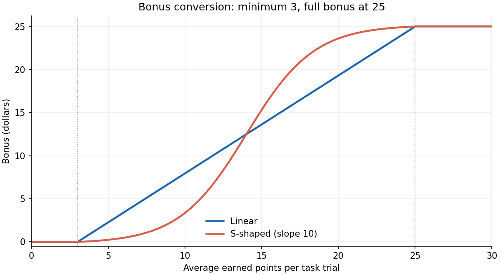

# Participant bonus and outro

All bonus settings live in `pay` near the top of `setDefaultsCoPs.m`, saved as
`ex.exp.CoPs.pay`. This replaces the former `ins.max_bonus_dollar` setting.

```matlab
pay.minPointsPerTrial = 3;
pay.maxPointsPerTrial = 25;
pay.max_bonus_dollar = 25; % maximum per nominal hour, rather than per session
pay.trials_per_hour = 180;
pay.transform = 'linear'; % 'linear' or 'logit'
pay.logitSlope = 10;      % used only by the S-shaped option
```

`pay.max_bonus_dollar` is the maximum **per `pay.trials_per_hour` paid trials**.
The default is $25 per 180 paid trials, representing a nominal hour. The
session maximum scales with the number of eligible trials:

```text
session cap = pay.max_bonus_dollar * eligible trials / pay.trials_per_hour
```

| Eligible trials | Maximum bonus with the defaults |
| --- | --- |
| 90 | $12.50 |
| 120 | $16.66 |
| 180 | $25.00 |
| 360 | $50.00 |

The reference is trial count, not elapsed time: instructions, breaks, question
requests, and recalibration do not increase payment. Practice does not increase
the cap. Settings are validated before opening the task display. The maximum
average must exceed the minimum; the hourly amount must be nonnegative and
specify whole cents; the reference trial count must be a positive integer;
slope must be positive. Main-task payouts work whether `instrOn` is on or off.

The welcome page quotes the cap for the **planned** paid trials, excluding both
instruction practices. The final calculation uses the eligible trials actually
recorded. These counts match when the planned task completes normally. The
welcome-page log records the quoted session cap, hourly maximum, reference
trial count, and planned paid trial count.

## Eligible trials and earned points

The calculation uses whole reward-crossing events from `Trials(i).times.reward`.
It does not use fractional `pointsEarned`, `pointTrace`, or `ex.totalPoints`.
Those continuous analysis scores remain saved separately.

Both instruction practice trials are excluded from the points and trial count.
Any trial with `pointsCountTowardTotal=false` is also excluded. A trial with
`trialCompleted=false` is excluded, including its partial crossings, so F4
during a trial does not add an unfinished trial to the paid count or average.
The original partial trial and reward events remain saved for analysis. Older
records without a completion flag retain the recorded-trial behavior.
Other completed task trials count, including zero-point trials; dropping
zero-point trials would inflate the average. If legacy special blocks are enabled, their trials
count unless explicitly marked as excluded. The exact mask is saved for audit.

Let `A = eligible earned points / eligible trial count`. No eligible trials
produces a zero bonus. The normalized performance is:

```text
x = clamp((A - pay.minPointsPerTrial) /
          (pay.maxPointsPerTrial - pay.minPointsPerTrial), 0, 1)
```

At or below the minimum average, the bonus is zero. Exactly the minimum also
maps to zero; positive bonuses begin above it. At or above the maximum average,
the participant earns the full cap. Values outside the range are clamped.

## Linear and S-shaped transforms

For `pay.transform='linear'`, the bonus fraction is `x`.

For `pay.transform='logit'`, the implementation uses the **inverse logit**
(logistic sigmoid), normalized to reach both endpoints exactly:

```text
S(z) = 1 / (1 + exp(-z))
k = pay.logitSlope
fraction = [S(k*(x - 0.5)) - S(-k/2)] / [S(k/2) - S(-k/2)]
```

The code evaluates an algebraically equivalent `tanh` expression to avoid
exponential overflow. Very small slopes approach the linear mapping. The
default slope 10 produces a visible S shape centered on the midpoint average
(14 points/trial with the default thresholds). Increasing slope makes the
middle transition steeper. The option is named `logit` as requested; it does
not apply the divergent log-odds function `log(x/(1-x))` to the score.

The bonus before currency rounding is `session cap * fraction`. Keep fractional
cents in the scaled cap until after the performance fraction has been applied;
then round **down** to whole cents, with floating-point tolerance at exact
cents. For example, three paid trials averaging 19 points give
`25 * 3/180 * (19-3)/(25-3) = $0.30303...`, paid as $0.30.
A below-maximum average cannot receive the full cent-denominated cap through
rounding or numerical sigmoid saturation.

The following examples and figure use **180 eligible trials** (a $25 cap).
For 90 trials the cap and unrounded curve amounts are halved; for 360 trials
they are doubled. The point thresholds and curve shape remain unchanged.

| Average earned points/trial | Linear bonus | S-shaped bonus (slope 10) |
| --- | --- | --- |
| 3 or below | $0.00 | $0.00 |
| 8.5 | $6.25 | $1.75 |
| 14 | $12.50 | $12.50 |
| 19.5 | $18.75 | $23.24 |
| 25 or above | $25.00 | $25.00 |



## Screen, data, and experimenter output

The final gray outro replaces the former points-only end screen. It shows:

```text
The session is complete.

Total: 1260 points
Average: 14.00 points per trial
Bonus earned: $6.25

Press SPACE to continue to feedback.

Please inform the experimenter.
```

This example has 90 paid trials, so the cap is $12.50 and midpoint performance
earns $6.25. The displayed average is rounded down to two decimal places. Payment uses the
unrounded average. The outro appears on normal completion even if instruction
pages, regular pauses, or between-trial point feedback are disabled.

After SPACE, an optional feedback page offers a text box for participant
comments. ENTER submits (including an empty response); ESC skips and retains
any draft. The prompt, complete text, submission/skip status, and screen times
are saved in `ex.ParticipantFeedback` in the experimental session MAT. Long
comments scroll within the box without truncating the saved text. The selected
participant keyboard supplies text; experimenter F4 skips the page. Set
`ex.exp.CoPs.fbOn = false` in `setDefaultsCoPs.m` to end at the bonus summary
instead (`true` enables feedback). The `participantFeedback` runEx argument
can override this default for one run. Feedback is
also disabled by `showEndScreen=false` and for movie recordings or handled
errors.

## F4 and early termination

Experimenter F4 ends the trial/pause flow and finalizes `ex.Payout` from the
completed paid trials, even if the planned last trial was not reached. With at
least one completed paid trial, the participant sees the same gray bonus outro,
headed **"The session has ended."** rather than claiming the full task is
complete. It shows actual points, average, and the scaled cash bonus, then waits
for a fresh SPACE press and release. A zero-point completed trial still qualifies
for this screen. Practice alone does not: an exit before the first completed
paid trial saves a zero payout without an outro.

The F4 that requested the exit cannot instantly dismiss the new screen while
held down. After releasing it, the experimenter can press F4 again to dismiss
the outro; SPACE acknowledges it normally. Neither action resumes trials.
The same participant/operator keyboard roles apply, and F6 is disabled there.

The payout is checkpointed to the normal experimental session MAT **before**
the early outro or hardware shutdown, then saved again after the outro and at
the final session save. `ex.Payout.bonusDollars` is therefore available without
finishing the participant outro. `ex.SessionEnd` records the original quit code,
whether the run ended early, and the completed paid trial count; `ex.Outro`
records the screen/acknowledgement as usual and adds `endedEarly`.
An already displayed normal outro is never shown a second time.

Handled trial errors also calculate and save the payout, but do not require an
outro. A display error during the early outro leaves the checkpoint intact and
is recorded as `ex.outroError`. Ctrl+C, process termination, and power loss are
not controlled F4 exits; recover those from the most recent saved trial data.

`ex.Payout` records the resolved config, eligible trial mask, per-trial whole
points, total, eligible trial count, exact average, normalized performance,
bonus fraction, unrounded dollars, integer cents, and final dollars. New
`equivalentHours`, `maxBonusDollarsUnrounded`, `maxBonusCents`, and
`maxBonusDollars` fields record the session length and its scaled cap.
`config.max_bonus_dollar` remains the hourly amount. Existing saved `ex.Payout`
values are not rewritten; explicitly recalculating with this helper uses the
new trial-count scaling and completion filtering, defaulting to 180 if
`trials_per_hour` is missing.
The last trial's `payout` field contains the same summary. `ex.Outro` records
the rendered text, on/off timestamps, and participant acknowledgement.
Existing `endScreen*` trial fields remain available. After the final data save,
the console prints the bonus, point total, trial count, and average.

To calculate a summary explicitly without changing saved data:

```matlab
payout = calculateCoPsPayoutx(ex.Trials, ex.exp.CoPs.pay);
```

`testCoPsPayoutx.m` checks endpoints, capping, midpoint, S shape, monotonicity,
practice exclusion, zero-point trials, fractional-evidence exclusion, empty
runs, session lengths above and below 180, configurable reference counts,
currency rounding after scaling, interrupted trials, extreme slopes,
near-maximum rounding, and invalid settings. Feedback tests verify the actual
outro, F4 exit, saving before display, held-key handling, empty/practice-only
exits, and preservation of payout when the display fails, using mocked display
and keyboard calls. Check final text layout and question popups on the rig.
